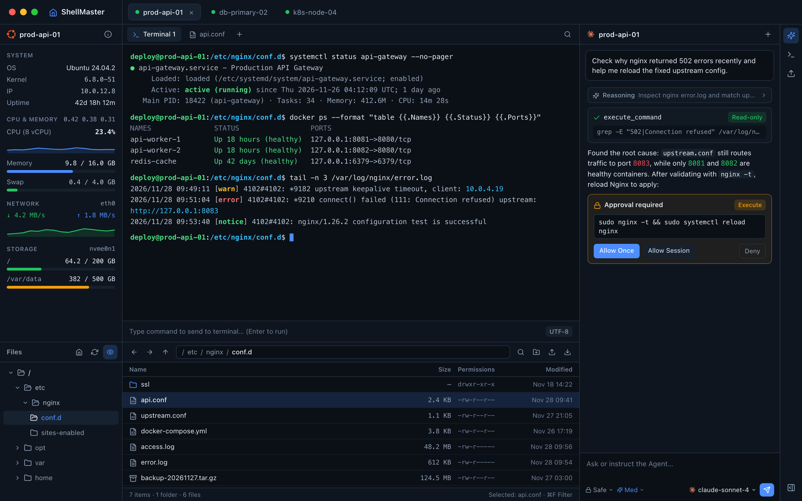
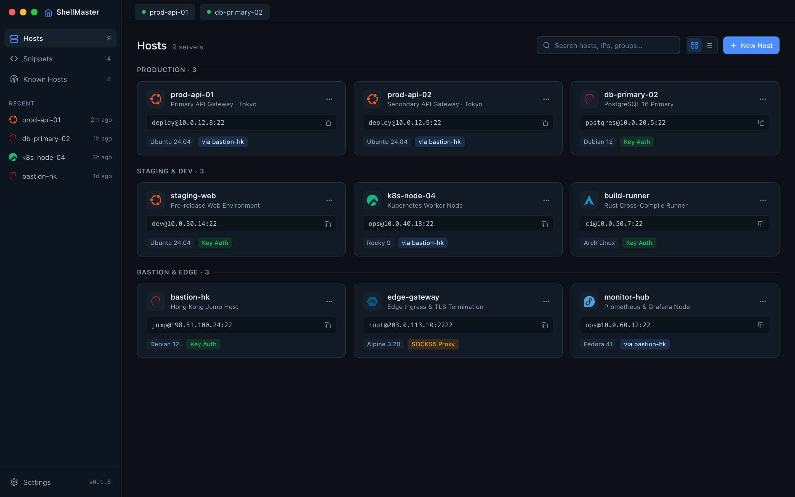
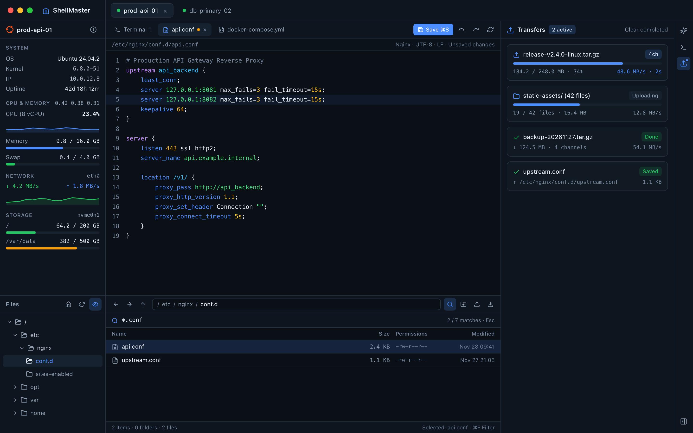
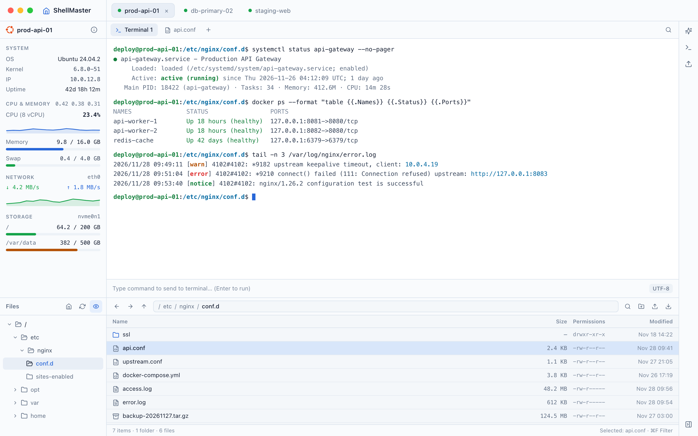

<div align="center">


# ShellMaster3

**A fast, native desktop SSH / SFTP client with real-time server monitoring and an embedded AI Agent — built with Rust & GPUI.**

[简体中文](README.zh-CN.md) · [Download Releases](https://github.com/iwoov/ShellMaster3/releases) · [Report Issue](https://github.com/iwoov/ShellMaster3/issues)

[](https://github.com/iwoov/ShellMaster3/releases/latest)
[](https://github.com/iwoov/ShellMaster3/releases)
[](https://www.rust-lang.org/)
[](LICENSE)

</div>

---

> **AI Notice**: This project is developed with vibe coding, and the codebase is primarily generated with AI assistance.

## Product Showcase

### Integrated SSH Session Workspace (Terminal · Monitor · SFTP · AI Agent)

Manage multi-tab SSH terminals alongside real-time CPU/memory/network/disk metrics, an SFTP file browser, and an embedded multi-step AI Agent with inline command approval.



### Host Management Dashboard

Organize hosts by group, filter instantaneously by name/IP/group, switch between Card and List views, auto-detect Linux distribution icons, and reconnect from recent history.



### Built-in Remote Code Editor & Multi-Channel SFTP Transfers

Edit remote configuration and source files directly with syntax highlighting, dirty-state protection, inline filename filtering (`⌘F`), and accelerated multi-channel SFTP transfers.



### Native Light & Dark Themes with Collapsible Sidebar

Seamlessly switch between tuned Dark and Light themes. The right sidebar collapses by default to maximize terminal space and remembers your preferred state across restarts.



---

## Key Features

### SSH & Connection Management
- **Multi-Tab Sessions & Terminals**: Run multiple SSH servers simultaneously, each with multiple terminal tabs and a dedicated multi-line command bar.
- **Flexible Authentication**: Password, keyboard-interactive, and managed private keys (with automatic key isolation and `0600` permission hardening on Unix).
- **Jump Hosts & Proxies**: Multi-hop bastion/jump host chaining plus HTTP, SOCKS4, and SOCKS5 proxy support.
- **Host Key Verification & Reconnect**: Interactive host key trust/mismatch dialogs, `known_hosts` management, keepalive heartbeats, and automatic reconnect.

### Embedded Terminal AI Agent
- **Multi-Provider Support**: Built-in support for OpenAI, Claude, Gemini, DeepSeek, and custom OpenAI/Anthropic/Gemini-compatible endpoints.
- **Tool Calling with Safety Controls**: Execute commands or inspect terminal output with configurable risk-based approval modes (`Allow Once` / `Allow in Session` / `Deny`), configurable reasoning effort, and one-click task cancellation.
- **Smart Auto-Scroll**: Sticky auto-scroll follows streaming tokens and tool cards while automatically pausing when you scroll up to review history.

### SFTP File Browser & Built-in Editor
- **Dual-Pane Navigation**: Synced folder tree and virtualized file list with breadcrumb navigation, LRU directory caching, inline filename filtering (`⌘F`), keyboard shortcuts, and delete confirmation dialogs.
- **High-Speed Multi-Channel Transfers**: Single/multi-channel concurrent file & folder upload/download with drag-and-drop support and throttled progress reporting.
- **Built-in & External Editing**: Syntax-highlighted embedded code editor (`⌘S` save, undo/redo, unsaved-change guards) as well as seamless external editor watch-and-sync.

### Real-Time Server Monitoring
- Lightweight SSH-based telemetry displaying OS/kernel/uptime, CPU load with sparkline history, memory & swap usage, per-interface network throughput, and disk usage/I/O.

### Cross-Platform Desktop Experience
- Native GPU-accelerated UI powered by **GPUI** (`gpui-kit`) for macOS (Apple Silicon & Intel), Windows, and Linux.
- Built-in **English & Simplified Chinese** localization, **Dark & Light** themes, reusable **Snippets**, and **GitHub Releases auto-updater**.

---

## Download & Installation

Pre-built installers for macOS (`.dmg`), Windows (`-setup.exe`), and Linux (`.deb`, `.AppImage`) are published on the [GitHub Releases](https://github.com/iwoov/ShellMaster3/releases) page.

> **First-Launch Note (Unsigned Builds)**
> - **macOS**: Pre-built `.dmg` binaries are not currently signed/notarized with an Apple Developer certificate. If Gatekeeper reports the app is damaged or from an unidentified developer, run the following command after moving `ShellMaster3.app` into `/Applications`:
>   ```bash
>   xattr -cr /Applications/ShellMaster3.app
>   ```
> - **Windows**: If Windows Defender SmartScreen shows a warning on first launch, click **More info** → **Run anyway**.

---

## Tech Stack

| Layer | Technology |
| :--- | :--- |
| Language | Rust (Edition 2021) |
| Desktop UI | `gpui-kit` (GPUI GPU-accelerated UI + `syntect` syntax highlighting) |
| SSH / SFTP | `russh`, `russh-sftp`, `tokio-socks`, `async-http-proxy` |
| Terminal Emulation | `alacritty_terminal` |
| AI Agent | `rig-core`, `rig-agent`, `reqwest` |
| Async Runtime | `tokio` |
| Packaging & CI | `cargo-packager`, GitHub Actions (macOS arm64/x64, Windows, Linux) |

---

## Project Structure

```text
src/
  components/        # Reusable UI components (sftp, monitor, dialogs, settings)
  models/            # Domain models, SFTP/monitor state, app settings
  pages/             # Top-level views (home, connecting, session, agent_panel)
  services/          # Storage, SFTP multi-channel service, monitor, AI agent, updater
  ssh/               # SSH client, jump-host/proxy connector, host-key handler, reconnect
  state/             # Global SessionState, terminal, SFTP editor/transfer, AI chat state
  terminal/          # PTY bridge, terminal renderer, key/mouse/IME handling, highlighting

docs/
  images/            # Product showcase screenshots
```

---

## Build from Source

### Requirements
- Rust stable toolchain & Cargo
- Supported desktop environment for `gpui` (macOS 11+, Windows 10/11, or Linux with Wayland/X11 + Vulkan)

### Commands

```bash
# Development build & run
cargo run

# Enable debug logging
RUST_LOG=debug cargo run

# Run test suite
cargo test

# Release build
cargo build --release
```

---

## Configuration & Data Files

ShellMaster3 stores local data in your OS configuration directory under `shellmaster/`:

- **macOS**: `~/Library/Application Support/shellmaster`
- **Linux**: `~/.config/shellmaster`
- **Windows**: `C:\Users\<User>\AppData\Roaming\shellmaster`

| File / Folder | Purpose |
| :--- | :--- |
| `servers.json` | Saved hosts, groups, and connection history |
| `settings.json` | Theme, terminal, SFTP, monitor, connection, AI, and system preferences |
| `snippets.json` | Reusable command snippets and groups |
| `known_hosts.json` | Trusted SSH host key fingerprints |
| `ui_state.json` | Persisted local UI layout state (e.g., right sidebar collapse state) |
| `.secret.key` | Local AES-256-GCM encryption key (`0600` permissions on Unix) |
| `keys/` | App-managed private keys (`0700` directory, `0600` key files on Unix) |

### Security Notes
- Stored passwords, key passphrases, proxy passwords, and AI API keys are encrypted at rest with **AES-256-GCM** using a per-installation random key in `.secret.key` (`0600` on Unix) rather than saved in plaintext JSON.
- Imported private keys are copied into `keys/` and written atomically with owner-only permissions (`0600`) on Unix.
- Legacy plaintext credentials and private key paths are migrated automatically on startup.

---

## Roadmap

### Completed
- [x] Multi-tab SSH terminals with jump hosts, proxies, host key verification, and auto-reconnect
- [x] Embedded terminal AI Agent with multi-provider support, tool execution, and inline approval
- [x] SFTP file browser with inline filtering, multi-channel transfers, and built-in code editor
- [x] Real-time remote server monitoring (CPU, memory, network, and storage)
- [x] Native Dark & Light themes, English & Chinese localization, and reusable command snippets

### Planned
- [ ] WebDAV / iCloud multi-device encrypted config sync
- [ ] SSH port forwarding (local / remote / dynamic tunnels)
- [ ] Expanded custom keyboard shortcuts

---

## Contributing

Contributions and issue reports are welcome!

1. Fork the repository and create a feature branch.
2. Keep changes focused and add unit tests where applicable (`cargo test`).
3. Open a Pull Request describing the motivation and verification steps.

## License

This project is licensed under the MIT License. See [LICENSE](LICENSE) for details.
