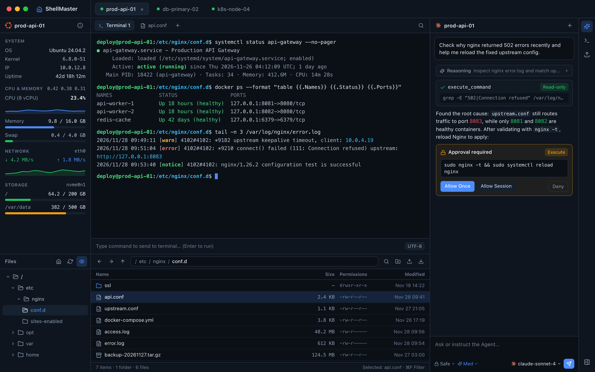
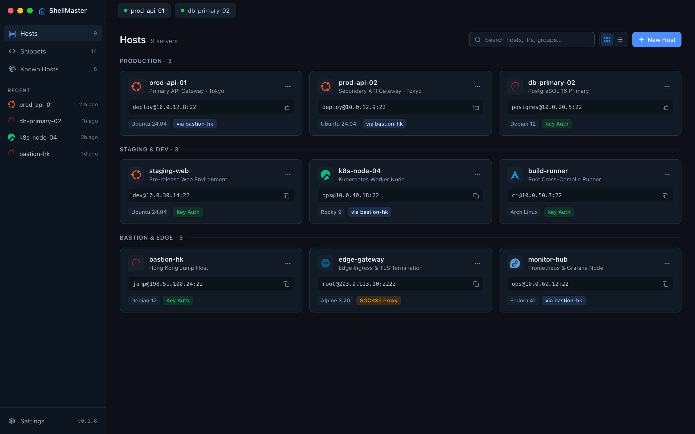
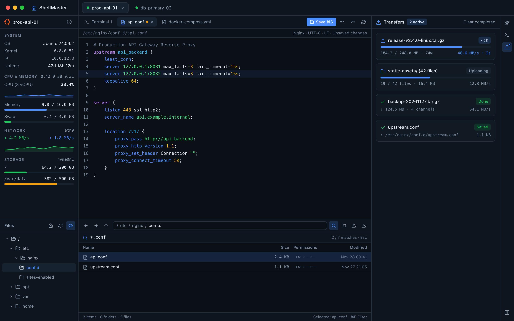
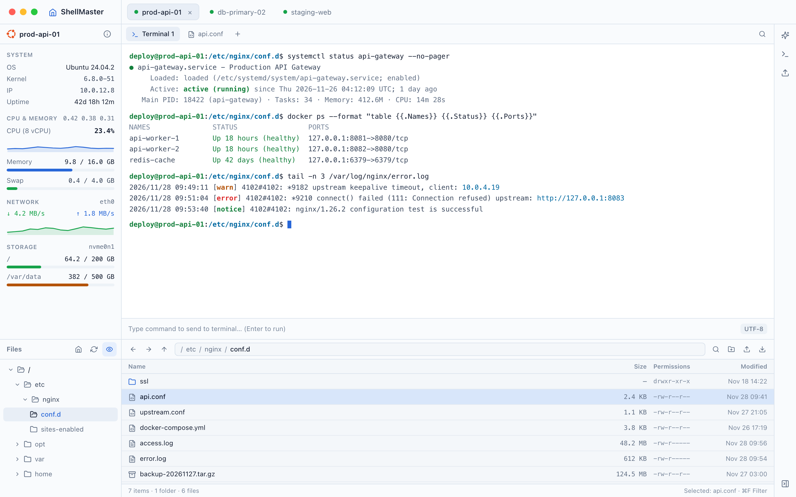

<div align="center">


# ShellMaster3

**基于 Rust 与 GPUI 构建的高性能原生桌面 SSH / SFTP 客户端，集成实时主机监控、内置代码编辑器与终端 AI Agent。**

[English README](README.md) · [下载安装包 (Releases)](https://github.com/iwoov/ShellMaster3/releases) · [反馈问题 (Issues)](https://github.com/iwoov/ShellMaster3/issues)

[](https://github.com/iwoov/ShellMaster3/releases/latest)
[](https://github.com/iwoov/ShellMaster3/releases)
[](https://www.rust-lang.org/)
[](LICENSE)

</div>

---

> **AI 声明**：本项目采用 vibe coding 开发，代码主要由 AI 协助生成。

## 产品展示

### 一体化 SSH 会话工作区（终端 · 实时监控 · SFTP · AI Agent）

在同一个原生窗口中高效协同：顶部多标签会话切换、左侧实时系统监控、中间多终端与 SFTP 文件浏览器、右侧内置 AI Agent（支持工具调用与危险命令内联审批）。



### 主机分组与连接管理主页

支持按分组管理服务器、按名称/IP/分组实时检索、卡片/列表视图切换、自动识别 Linux 发行版图标，以及一键从最近连接恢复会话。



### 内置远程代码编辑器与多通道 SFTP 传输

直接在会话中打开并编辑远程配置文件与代码（语法高亮、`⌘S` 保存、未保存变更二次确认），配合文件名内联过滤（`⌘F`）与多通道并发传输管理器大幅提升运维效率。



### 深浅双色主题与可折叠侧边栏

精心调校的深色与浅色双主题；右侧侧边栏默认折叠以最大化终端视野，并自动记住你上次的展开/收起状态。



---

## 核心特性

### SSH 与连接管理
- **多标签会话与多终端**：同时连接多台服务器，单会话内支持多终端标签与底部多行命令输入栏。
- **多种认证方式**：支持密码认证、键盘交互认证与私钥托管（Unix 下自动隔离至 `keys/` 并收紧 `0600` 权限）。
- **跳板机与代理**：支持多级跳板机链路，以及 HTTP / SOCKS4 / SOCKS5 代理。
- **主机密钥校验与断线重连**：提供首次信任与密钥变更告警弹窗、Known Hosts 管理、心跳保活与自动重连。

### 终端内置 AI Agent
- **多模型供应商**：内置支持 OpenAI、Claude、Gemini、DeepSeek，以及自定义兼容接口。
- **可控的工具执行与安全审批**：Agent 可读取终端上下文并协助排查/执行命令；提供分级风险审批模式（`允许本次` / `本次会话允许` / `拒绝`）、思考深度调节及一键中断。
- **智能贴底跟随**：流式输出时自动保持最新内容在可视区底部；手动上翻查看历史时自动暂停跟随，并提供一键回底按钮。

### SFTP 文件浏览器与内置编辑器
- **双栏高速浏览**：目录树与文件列表联动，支持面包屑导航、LRU 目录缓存、内联文件名过滤（`⌘F`）、键盘快捷键、符号链接智能打开及删除二次确认。
- **多通道并发传输**：支持文件与文件夹的拖放上传/下载、多通道并行加速与进度节流聚合。
- **内置 + 外置双编辑模式**：支持语法高亮的内置远程代码编辑器，也支持调用本地外置编辑器并自动监听回传。

### 实时服务器监控
- 通过轻量 SSH 采集展示系统/内核/运行时长、CPU 负载与折线趋势、内存与 Swap、按网卡切换的实时网络吞吐以及磁盘容量与 I/O。

### 原生跨平台体验
- 基于 **GPUI**（`gpui-kit`）GPU 加速渲染，原生支持 macOS（Apple Silicon / Intel）、Windows 与 Linux。
- 内置 **简体中文 / English** 双语切换、**深色 / 浅色** 主题、**快捷命令（Snippets）** 与 **GitHub Releases 自动更新**。

---

## 下载与安装

可直接前往 [GitHub Releases](https://github.com/iwoov/ShellMaster3/releases) 下载对应平台的预构建安装包：
- **macOS**：`ShellMaster3_*_aarch64.dmg`（Apple Silicon） / `ShellMaster3_*_x64.dmg`（Intel）
- **Windows**：`shellmaster3_*_x64-setup.exe`
- **Linux**：`shellmaster3_*_amd64.deb` / `shellmaster3_*_x86_64.AppImage`

> **首次打开说明（未签名安装包）**
> - **macOS**：目前预构建的 `.dmg` 尚未经过 Apple Developer 签名与公证。若安装后系统提示“已损坏，无法打开”或“无法验证开发者”，将 `ShellMaster3.app` 拖入「应用程序」后在终端执行：
>   ```bash
>   xattr -cr /Applications/ShellMaster3.app
>   ```
> - **Windows**：首次运行若出现 Windows Defender SmartScreen 提示，点击「更多信息」→「仍要运行」即可。

---

## 技术栈

| 模块 | 技术选型 |
| :--- | :--- |
| 开发语言 | Rust（Edition 2021） |
| 桌面 UI | `gpui-kit`（GPUI GPU 加速界面 + `syntect` 语法高亮） |
| SSH / SFTP | `russh`、`russh-sftp`、`tokio-socks`、`async-http-proxy` |
| 终端模拟 | `alacritty_terminal` |
| AI Agent | `rig-core`、`rig-agent`、`reqwest` |
| 异步运行时 | `tokio` |
| 打包与发布 | `cargo-packager`、GitHub Actions（macOS / Windows / Linux） |

---

## 项目结构

```text
src/
  components/        # 通用 UI 组件（SFTP、监控、弹窗、设置）
  models/            # 领域模型、SFTP/监控状态与配置模型
  pages/             # 主页面（home、connecting、session、agent_panel）
  services/          # 本地存储、SFTP 多通道服务、监控、AI Agent、自动更新
  ssh/               # SSH 客户端、跳板机/代理连接器、Host Key 处理与重连
  state/             # 全局 SessionState、终端、SFTP 编辑器/传输与 AI 对话状态
  terminal/          # PTY 桥接、终端渲染、按键/鼠标/IME 与关键字高亮

docs/
  images/            # 产品展示截图
```

---

## 从源码构建

### 环境要求
- Rust 稳定版工具链与 Cargo
- `gpui` 支持的桌面环境（macOS 11+、Windows 10/11，或带 Wayland/X11 与 Vulkan 的 Linux）

### 常用命令

```bash
# 开发运行
cargo run

# 开启调试日志
RUST_LOG=debug cargo run

# 运行单元测试
cargo test

# 发布模式构建
cargo build --release
```

---

## 配置与数据文件

ShellMaster3 会在系统配置目录下创建 `shellmaster` 文件夹保存本地数据：

- **macOS**：`~/Library/Application Support/shellmaster`
- **Linux**：`~/.config/shellmaster`
- **Windows**：`C:\Users\<用户名>\AppData\Roaming\shellmaster`

| 文件 / 目录 | 说明 |
| :--- | :--- |
| `servers.json` | 服务器列表、分组与最近连接记录 |
| `settings.json` | 主题、终端、SFTP、监控、连接、AI 与系统偏好设置 |
| `snippets.json` | 快捷命令与分组配置 |
| `known_hosts.json` | 已信任的 SSH 主机密钥指纹 |
| `ui_state.json` | 本地界面布局记忆（如右侧侧边栏折叠状态与面板） |
| `.secret.key` | 本地 AES-256-GCM 加密密钥（Unix 下 `0600` 权限） |
| `keys/` | 应用托管的私钥目录（Unix 下目录 `0700`、文件 `0600`） |

### 安全说明
- 服务器密码、私钥口令、代理密码及 AI API Key 在落盘前均使用 **AES-256-GCM** 加密（密钥保存在本机 `0600` 权限的 `.secret.key` 中），不再以明文保存在 JSON 配置中。
- 导入的私钥会复制到 `keys/` 目录中统一管理，Unix 下采用原子写入并设置仅当前用户可读写（`0600`）。
- 启动时会自动将历史明文凭据升级为密文，并自动迁移旧版私钥路径。

---

## 路线图

### 已完成
- [x] 多标签 SSH 终端（支持跳板机、代理、主机密钥校验与自动重连）
- [x] 终端内置 AI Agent（多供应商接入、多步工具调用与内联危险命令审批）
- [x] SFTP 文件浏览器（内联过滤、多通道并发传输与内置远程代码编辑器）
- [x] 实时远程服务器监控（CPU、内存、网络与磁盘状态）
- [x] 原生深浅双色主题、中英文界面与快捷命令管理

### 计划中
- [ ] 基于 WebDAV / iCloud 的多端加密配置同步
- [ ] SSH 端口转发（本地 / 远程 / 动态隧道）
- [ ] 更丰富的自定义快捷键体系

---

## 贡献指南

欢迎提交 Issue 与 Pull Request：

1. Fork 仓库并创建功能分支。
2. 保持改动聚焦，并通过本地测试（`cargo test`）。
3. 提交 PR 时附带变更说明与验证结果。

## 许可证

本项目采用 MIT 许可证，详见 [LICENSE](LICENSE)。
